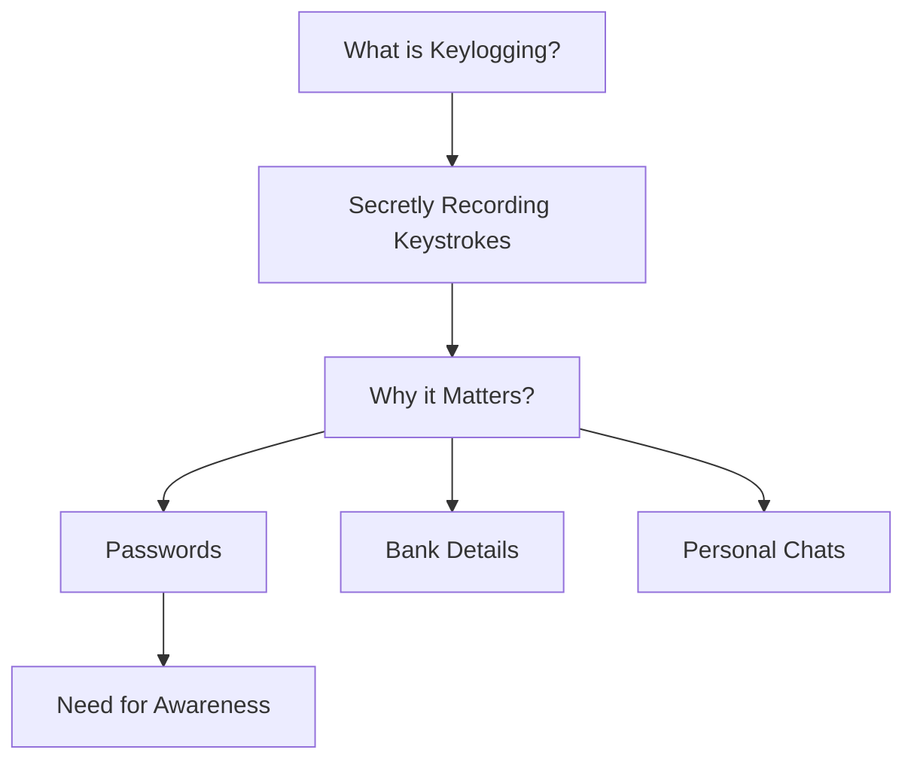
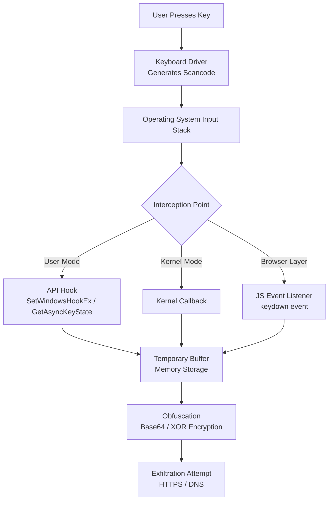
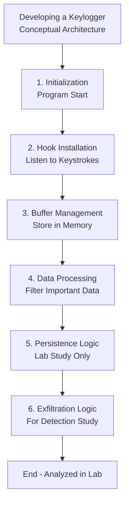
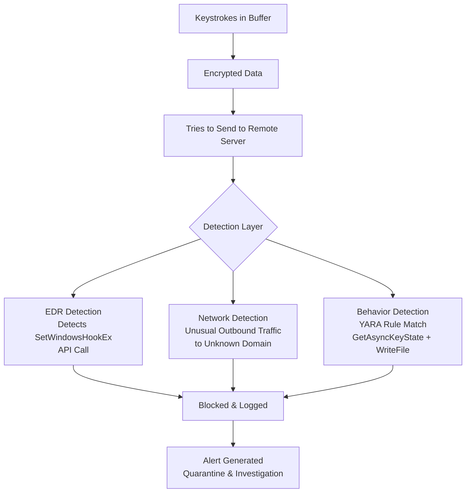

# Introduction to Keylogging & Detection Guide

## 1. Introduction to Keylogging

**Simple:** Keylogging is secretly recording whatever a user types on a keyboard.

**Technical:** It is the process of intercepting `keyboard input events` at the OS level. The input from the hardware driver is captured before it reaches the target application using API hooking or kernel callbacks.

## 2. How Keylogging Works?

**Simple Flow:** User types -> OS receives it -> Someone in middle copies it -> Saves in memory -> Sends out.

**Technical Flow:** Physical Key Press -> Keyboard Driver generates Scancode -> Windows Input Stack -> Hook intercepts via SetWindowsHookEx -> Data stored in Buffer.

## 3. Developing a Keylogger - Conceptual ArchitectureNote:

    Note: This section explains the conceptual modules for educational purpose, not the actual coding implementation.

A keylogger logically has 5 modules:

**1. Initialization Module:** How the program starts.

**2. Hooking Module:** How it listens to keyboard events. (Tech: WH_KEYBOARD_LL)

**3. Buffer Module:** How it stores data temporarily. (Tech: RAM / Temp File)

**4. Persistence Module:** How it stays active after restart. (Tech: Registry Run Key / Startup Folder) - Studied for detection.

**5. Exfiltration Module:** How data is sent out. (Tech: HTTP POST)

## 4. How to Detect Keylogging?
# Level 1: Basic Detection
* Check Task Manager > Startup for unknown apps.
* Unusual keyboard lag or delay.
* Run full Antivirus / Windows Defender scan.

# Level 2: Technical Detection

* **Process Level**: Use Autoruns (Sysinternals) to see hidden DLLs.
* **Network Level:** Use Wireshark or Firewall logs to see data going to unknown IP.
* **Rule Based:** YARA Rule flags file containing keylogging APIs + network APIs together.

## 5. How to Prevent?

1. Do not install cracked / unknown software.
2. Keep Windows Defender Real-time Protection ON.
3. Use 2FA / MFA - Even if password leaks, account stays safe.
4. Use On-Screen Keyboard for banking.
5. Keep Browser and OS updated.

## 6. Conclusion
Understanding keylogging is not to misuse it, but to understand how data theft happens and how we can defend against it. This guide is for awareness and defense.
